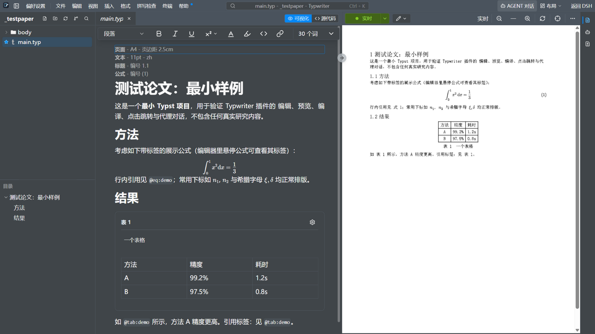
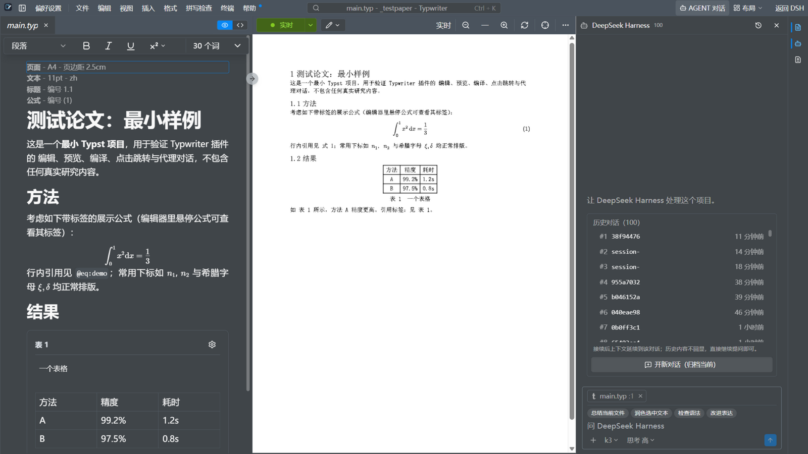
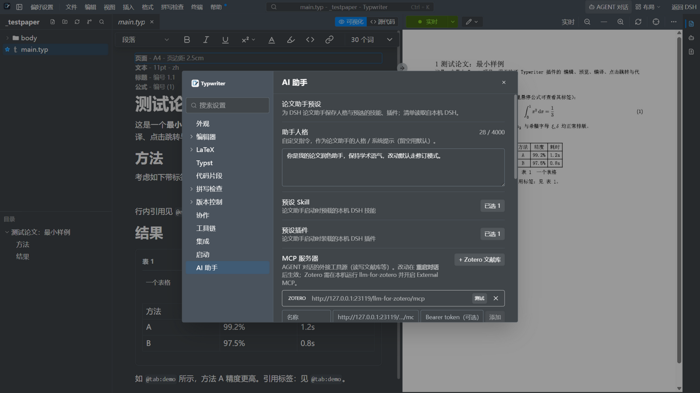
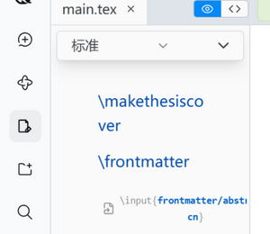

# Typwriter

**A DeepSeek Harness (DSH) plugin that turns the editor into a Typst / LaTeX paper-writing workbench — with a DSH agent living in the sidebar.**

把 DSH 变成论文写作台：可视化编辑、实时预览、PDF 审阅，以及一个住侧栏里、能读你文献库的 DSH 智能体。



---

## 它能做什么

### ✍️ 论文级编辑面（继承自 [Texpile](https://github.com/texpile/texpile)）

- **可视化编辑**：所写即所得的 Typst 正文，公式双击进入 MathLive 编辑，悬停查看公式标签
- **实时预览**：tinymist 驱动的 PDF 预览，点击跳转、光标跟随
- **源码 / 可视化双模**，三栏布局，右缘活动栏一键切换 **PDF 审阅 / AGENT 对话 / 代码修改**

### 🤖 AGENT 对话（接 DSH 本体）



- 与 DSH 对话，**模型与思考强度切换**直接对齐 DSH 本体的模型列表（pi-ai 目录 ∩ 你的凭证），新对话即生效
- **会话历史**：查看 / 接续 / 归档过往对话
- 左侧文件树**拖文件进对话**即是上下文；空输入框自带「总结 / 润色 / 检查语法」快捷指令
- 进入 Typwriter 即后台**预热** agent 进程，打开面板不用等冷启动

### 🔌 MCP 外接工具（如 Zotero 文献库）



在 **偏好设置 → AI 助手 → MCP 服务器** 里添加任意 streamable-http MCP 端点，AGENT 即获得其全部工具。内置 **「+ Zotero 文献库」一键接入**（自动读取 [llm-for-zotero](https://github.com/yilewang/llm-for-zotero) 的凭证）——检索文献、读条目、写笔记、打标签、导入，直接在论文对话里完成。

### 🧠 论文助手预设

人格（系统提示）+ 预载技能 / 插件选择器，读的是**本机 DSH 真实清单**（`~/.dsh`），不是写死的列表。

## 安装

入口在 DSH 侧栏：**插件 → Typst 写作台**（插件按钮下方）。



```bash
# 1) 构建前端（Node ≥ 24, pnpm ≥ 9）
pnpm install
pnpm --filter texpile-editor exec vite build --outDir dist-typwriter --base /typwriter/app/

# 2) 拷入插件目录
cp -r apps/texpile-editor/dist-typwriter/* plugin/dsh-typwriter/app/

# 3) 装进某个 DSH profile（以 web 为例；desktop 同理）
cd ~/.dsh/profiles/web
echo '"dsh-typwriter": "link:<本仓库路径>/plugin/dsh-typwriter"' >> package.json  # 加入 dependencies
pnpm install
# 并把 "dsh-typwriter" 追加到 package.json 的 dsh.profile.bundles 数组，重启 DSH
```

**工具链**：需要 `typst` 与 `tinymist` 在 PATH 或 `plugin/dsh-typwriter/bin/`（不入库，52 MB + 64 MB，见 [typst releases](https://github.com/typst/typst/releases) / [tinymist releases](https://github.com/Myriad-Dreamin/tinymist/releases)；验证版本 typst 0.15.1 / tinymist 0.15.12）。

## 架构

```
DSH 宿主（桌面 / Web，同一套）
 └─ plugin/dsh-typwriter
     ├─ src/host/*.js      宿主半片：/typwriter 静态路由 + RPC + SSE 事件总线
     │                      └─ 子进程：tinymist（LSP+预览）· typst（编译）· dsh --profile acp（AGENT）
     ├─ src/browser/shim.js 浏览器垫片：window.texpileNative* → HTTP/SSE，Texpile 渲染端零改动
     ├─ src/client/index.js DSH 入口注册（侧栏按钮 + 主区 iframe）
     └─ app/                构建好的编辑器 SPA
```

- 渲染端在**同源 iframe** 里跑，Tailwind 不污染 DSH 主题
- 所有单向事件（LSP 帧、终端输出、AGENT 事件）走一条 SSE 流
- 对 Texpile 上游的每一处修改都记录在 `scripts/patches.mjs`（`--list` 可查），改动守则见 [`PATCHING.md`](PATCHING.md)

## 开发调试

```bash
node plugin/dsh-typwriter/scripts/dev-server.mjs 4400 [论文目录]   # 独立宿主，免装进 DSH
pnpm run preflight                                                # 补丁锚点 + svelte 结构检查（≈1 s）
pnpm --filter texpile-editor check && pnpm --filter texpile-editor lint && pnpm --filter texpile-editor testonce
```

设计与验收记录（中文）在 [`docs/typwriter/`](docs/typwriter/)。

## 已知限制

- 无文件监视：外部改动需重开文件才可见
- Electron 集成测试套件尚未适配本 fork（CI 中已停用，见 `.github/workflows/test.yml`）
- macOS 应用图标未提供（随上游品牌素材一并移除）

## 与 Texpile 的关系

Typwriter 是 [Texpile](https://github.com/texpile/texpile) 的 **AGPL-3.0 fork**，编辑面来自 Texpile；本 fork 贡献了宿主桥接、AGENT 面板、MCP 管理与布局增强。

> 本项目与 Texpile 项目**无隶属、无背书关系**。"Texpile" 名称与标志为其商标；本 fork 使用**自己的名称与原创美术**。见 [`NOTICE`](NOTICE)。

## 许可

**AGPL-3.0** —— 见 [`LICENSE`](LICENSE)。作为 Texpile 的衍生作品，我们的修改同样适用该许可；若以网络服务形式运行修改版，AGPL §13 要求向用户提供对应源码。
